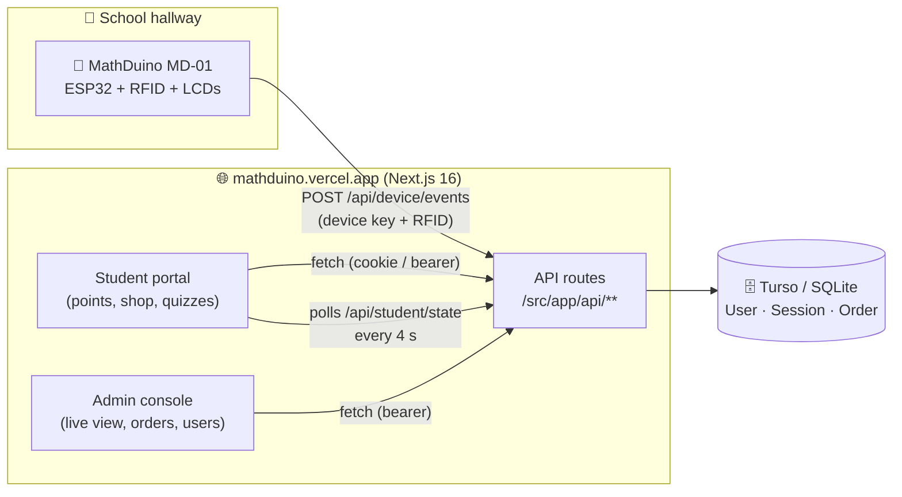
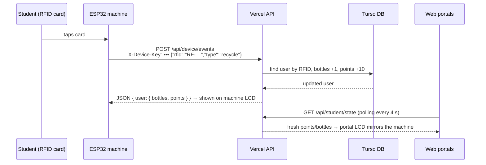

# 🏗️ MathDuino Architecture

A guided tour of the codebase — what lives where and how the pieces talk to each other.
Read this top-to-bottom and you'll understand every file's job.

---

## 1. The big picture



- **One Next.js app** serves everything: the student site, the admin console and the machine-facing API.
- **One database** (Turso in production, a local SQLite file in development — the code switches automatically, see `src/lib/db.ts`).
- **The ESP32 never uses accounts or cookies** — it authenticates with one shared device key and identifies students by their RFID card.

---

## 2. Life of a bottle 🍾

What happens when a student drops a bottle into the machine:



The student portal and admin live view never learn about the bottle directly —
they **poll** and see the database change. That's the whole sync trick.

---

## 3. Folder map — where to look for things

```
src/
├── app/
│   ├── page.tsx                  ← single route: renders AuthGate → Student/Admin portal
│   └── api/                      ← ALL backend endpoints (one folder per URL)
│       ├── auth/                 ← login · signup · session · logout · social
│       ├── device/events/        ← 🤖 MACHINE-ONLY: bottle + quiz from ESP32 (device key)
│       ├── student/
│       │   ├── state/            ← live poll endpoint (portal refreshes from here)
│       │   ├── events/           ← web-side recycle / quiz actions
│       │   └── orders/           ← GET list · POST redeem · DELETE remove/refund
│       ├── admin/
│       │   ├── orders/           ← GET all orders · PATCH status (ready/received/cancel)
│       │   └── device/           ← admin-only: reveals device key for firmware setup
│       └── health/               ← diagnostics: DB mode + counts (also machine "am I online?")
│
├── components/mathduino/
│   ├── auth-gate.tsx             ← sign-in / sign-up screens, then routes by role
│   ├── student/
│   │   ├── portal.tsx            ← main student screen (stats, LCD mirror, polling)
│   │   ├── quiz-panel.tsx        ← timed math quiz
│   │   ├── reward-shop.tsx       ← shop grid + redeem buttons
│   │   └── orders-dialog.tsx     ← order history with remove/refund rules
│   ├── admin/
│   │   ├── portal.tsx            ← tab shell for the five admin views
│   │   ├── live-view.tsx         ← real-time machine + student activity
│   │   ├── orders-view.tsx       ← fulfilment board (ready / receive / cancel)
│   │   ├── users-view.tsx        ← accounts, points, RFID assignment
│   │   ├── reports-view.tsx      ← recycling + quiz analytics
│   │   └── hardware-config-view.tsx ← firmware values, Device Sync API card
│   └── shared/
│       └── lcd-screen.tsx        ← the 16x2 LCD look, reused by portal & live view
│
└── lib/
    ├── db.ts                     ← Prisma singleton (SQLite file ↔ Turso auto-switch)
    ├── auth.ts                   ← server-only: sessions, password hashing (scrypt),
    │                               reads auth from cookie OR bearer token
    ├── auth-types.ts             ← client-safe helpers: token storage, authRequest()
    ├── mathduino.ts              ← shared types, shop catalogue, point constants
    └── order-types.ts            ← order statuses + state-machine helpers

prisma/
├── schema.prisma                 ← 3 tables: User, Session, Order
└── seed.ts                       ← demo accounts (bun prisma/seed.ts)

scripts/
└── turso-push.ts                 ← create tables in Turso (bun run db:push:turso)
```

---

## 4. The five ideas that make it work

### 1️⃣ Dual authentication (cookie **and** bearer)
Browsers get an `httpOnly` cookie. The ESP32 and the sandboxed preview can't use
cookies, so every auth endpoint also returns a **token** in the JSON body and
accepts it back as `Authorization: Bearer <token>`. `src/lib/auth.ts` tries the
header first, then falls back to the cookie. One mechanism, every client works.

### 2️⃣ Dual database mode (file **and** Turso)
`src/lib/db.ts` looks at `DATABASE_URL`: `file:` → plain SQLite for development,
`libsql://` → Turso with an auth token for production. Same schema, same queries,
zero code changes between laptop and Vercel.

### 3️⃣ Machine auth = one shared key + RFID
The ESP32 has no user accounts. It sends `X-Device-Key` (a shared secret, also
settable in Vercel env vars) and identifies the student by the RFID UID stored on
their profile. Admins can view the key in Hardware Config; it's never in the
public client bundle.

### 4️⃣ Order state machine
```
PENDING ──→ READY ──→ RECEIVED
   │
   └──→ CANCELLED (admin cancels → points auto-refund)
```
Students may **remove** PENDING (refund + restock), RECEIVED or CANCELLED rows
from their history — but only admins touch READY. `lib/order-types.ts` holds the
rules; the API enforces them (409 if a student tries to cancel a READY order).

### 5️⃣ Polling = live sync
The machine writes to the DB; the portals **poll** `/api/student/state` every
4 s (student) and the admin live view on its own timer. No websockets needed —
simple, deployable anywhere, and fast enough for a hallway machine.

---

## 5. API cheat sheet

| Endpoint | Auth | Purpose |
|---|---|---|
| `POST /api/auth/login` | — | sign in → cookie + bearer token |
| `POST /api/auth/signup` | — | create student (or admin with code) |
| `GET  /api/auth/session` | cookie/bearer | current user |
| `POST /api/auth/logout` | cookie/bearer | end session |
| `POST /api/device/events` | `X-Device-Key` | 🤖 machine: recycle / quiz by RFID |
| `GET  /api/student/state` | cookie/bearer | live poll for the portal |
| `POST /api/student/events` | cookie/bearer | web-side recycle / quiz |
| `GET/POST/DELETE /api/student/orders` | cookie/bearer | list / redeem / remove orders |
| `GET/PATCH /api/admin/orders` | **admin** | fulfilment board |
| `GET  /api/admin/device` | **admin** | device key + firmware values |
| `GET  /api/health` | — | diagnostics (DB mode, user count) |

---

## 6. Common tasks

| I want to… | Do this |
|---|---|
| Run locally | `bun install` → `cp .env.example .env` → `bun run db:push` → `bun prisma/seed.ts` → `bun run dev` |
| Change point values / shop items | edit `src/lib/mathduino.ts` (`POINTS_PER_BOTTLE`, `SHOP_ITEMS`) |
| Change the reward rules for removing orders | edit `src/lib/order-types.ts` + `DELETE` in `api/student/orders` |
| Add a database field | edit `prisma/schema.prisma` → `bun run db:push` → use via `src/lib/db.ts` |
| Create tables on a fresh Turso DB | `bun run db:push:turso` |
| Check a deployed app is alive | open `/api/health` |
